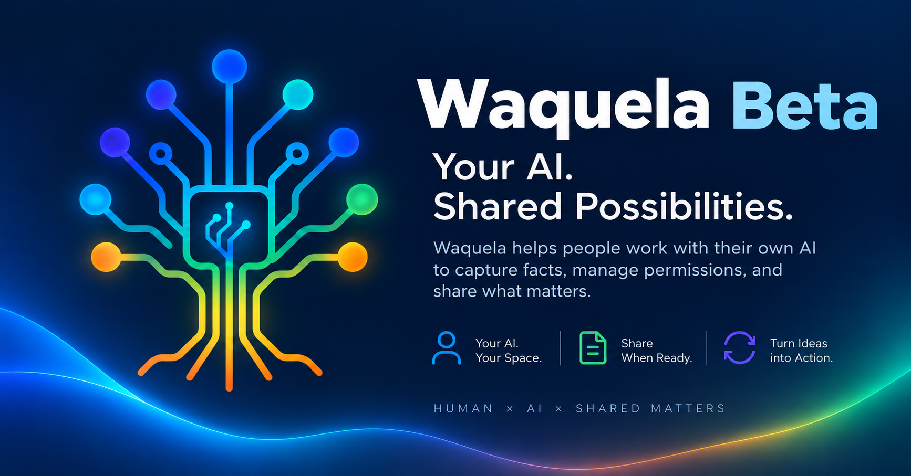

<p align="center">
  
</p>

# Waquela

**Your AI. Shared Possibilities.**

Your AI works with you.<br>
Waquela helps you work with others.

A human-directed workspace for AI-assisted information and collaboration.

[Visit the Waquela website](https://digist-sg-beta.web.app) · [Product overview](docs/overview.md) · [Beta notes](docs/beta.md)

## What is Waquela?

Waquela is an experimental, human-directed workspace powered by CKD.

Work with others on a shared matter while each person retains control of their own information and decisions. Organize information in Cards, ask a supported AI connection for help, and review proposed changes before deciding which supported changes to apply. You control what becomes accepted information and what you choose to share.

Owners can publish selected Card snapshots and receive external information through personal Transaction Offices. AI capabilities vary by client, account, plan, platform, and version.

## One Matter. Multiple People. Their Own AI.

### Example: Buying a Used Car

The participants in this example are fictional.

- A buyer uses ChatGPT to organize a car purchase in a Waquela Card and publishes selected requirements.
- A seller using Claude can review the public information and submit an offer through an available submission path.
- An inspector can contribute a vehicle report.
- A family member can provide advice through their own AI-assisted workflow.

The buyer reviews the incoming information, compares proposals, and decides what to accept. Each participant retains control of their own information and decisions.

```text
Buyer + ChatGPT
    |
    v
Purchase Card
    |
    v
Publish Selected Requirements
    |
    +---- Seller + Claude ---- Offer
    |
    +---- Inspector ---------- Report
    |
    +---- Family Member ------ Advice
    |
    v
Transaction Office / Inbox
    |
    v
Buyer + AI Review
    |
    v
Human Decision
    |
    v
Supported Proposal / Apply
    |
    v
Updated Current
```

Offers, reports, and advice remain external submissions for review. Updating Current requires a supported Proposal and explicit Human authorization to Apply; incoming information is not automatically converted into Card facts, and a purchase is not automatically completed.

This scenario combines existing Waquela Beta capabilities with an illustrative multi-party workflow. Individual interaction paths have been implemented and tested, while the complete used-car transaction scenario has not yet undergone end-to-end acceptance.

The implemented and tested foundation includes Cards, Publication, Public Discovery, Transaction Offices, Submissions, Inbox, Proposal / Apply, and two-person, multi-AI transaction interactions. Continuous collaboration among three or more people and the complete used-car workflow have not yet undergone end-to-end acceptance. This example makes no claim of automated matching, verified vehicle inspections, identity verification, payments, escrow, or guarantees.

## Current Beta Features

| Area | What you can do |
| --- | --- |
| Cards | Create Markdown-backed Cards, discover your Cards, and read their current accepted information. |
| Proposed changes | Save Proposals for review. Explicitly authorize supported changes to a Card title, Node facts, or a Markdown section body, with revision checks. |
| Private and public information | Keep Cards private, use scoped sharing where available, or publish selected snapshots for public viewing. Withdraw available publications when needed. |
| Public discovery | Browse available public Card publications without signing in. Private Cards require appropriate access. |
| Transaction Offices | Receive external submissions through a personal public Office and review them in your private Inbox. |
| AI and web access | Use the English-first web interface and supported CKD Beta MCP connections. ChatGPT connection and representative Card workflows have been Human-tested. |

Not every saved Proposal is executable. Approval alone does not make an unsupported change applicable. See [feature boundaries](docs/features.md).

## How It Works

### Working with your AI

```text
Human
  ↓
AI Assistant
  ↓
Waquela / CKD
  ↓
Card / Saved Proposal
  ↓
Human Review
  ↓
Supported Accepted Change
  ↓
Updated Current
```

Read a Card, request assistance, save a proposed change, then explicitly authorize a supported Apply. Revision checks help prevent an update based on an outdated version.

### Receiving external information

```text
Visitor
  ↓
Public Transaction Office
  ↓
Owner Inbox
  ↓
Human Review
```

Visitor identity and reply methods are self-declared and unverified. A submission does not automatically modify a Card or become an accepted change.

## Try Waquela Beta

[Visit the Waquela website](https://digist-sg-beta.web.app) to explore the public introduction and current connection guidance.

**Experimental Beta:** access and features may be limited during the Beta period. This showcase is informational; broad public recruitment is on hold. Full service is not guaranteed for every visitor.

Read the [Beta notes](docs/beta.md) before using the service. Use non-sensitive test information and avoid critical tasks.

## Supported AI Connections

| AI client | Current status |
| --- | --- |
| ChatGPT | Supported and Human-tested for representative workflows. |
| Claude | Supported, but not fully accepted across all workflows. |
| Grok | Limited / experimental. |
| Codex | Limited / experimental. |

AI tool availability and behavior may vary by client. Some workflows remain under validation. See the [feature boundaries](docs/features.md) and [Beta notes](docs/beta.md) for details.

Use the current CKD Beta MCP installation guidance on the website. The technical connection name remains CKD Beta MCP.

## Screenshots

**Public brand visual**



Product screenshots are pending review. Future screenshots will use public pages or non-sensitive demonstration content.

**Product walkthrough video — Buying a Used Car:** pending recording and review. This fictional collaboration scenario is the narrative for the future walkthrough. A video link will be added here when an approved recording is available.

## Experimental Status

Features may change, and availability is not guaranteed. Do not use Waquela Beta for critical tasks or store sensitive information. AI connection support varies.

Published snapshots are publicly accessible. Withdrawal stops availability through Waquela but does not erase historical records or copies already obtained by others.

External submissions require Human review. They do not establish verified identities, automatically create trusted relationships, or authorize AI to act independently.

## Feedback

- [Official Transaction Office](https://digist-sg-beta.web.app/@waquela)
- [Email feedback](mailto:digistreet.feedback@gmail.com)

Feedback is voluntary, with no guaranteed response time. Share only non-sensitive observations. The Office accepts information for review; it is not an identity verification service or an automatic support system.

## Roadmap

We are exploring more flexible Card presentation, broader AI-client interoperability, richer collaboration, Relation and context exploration, Agent-assisted workflows, and future spatial / 3D interaction.

These are concepts under exploration. Not all features are implemented, and no release dates or delivery commitments are set. See the [roadmap](docs/roadmap.md).

## Project Status

**This repository is a public product showcase. The CKD implementation source code is not included.**

The service is in experimental Beta. This repository contains product descriptions and reviewed public brand assets. No open-source implementation license is included.

[Overview](docs/overview.md) · [Features](docs/features.md) · [Architecture](docs/architecture.md) · [Beta notes](docs/beta.md) · [Roadmap](docs/roadmap.md) · [Publication manifest](PUBLICATION_MANIFEST.md)
